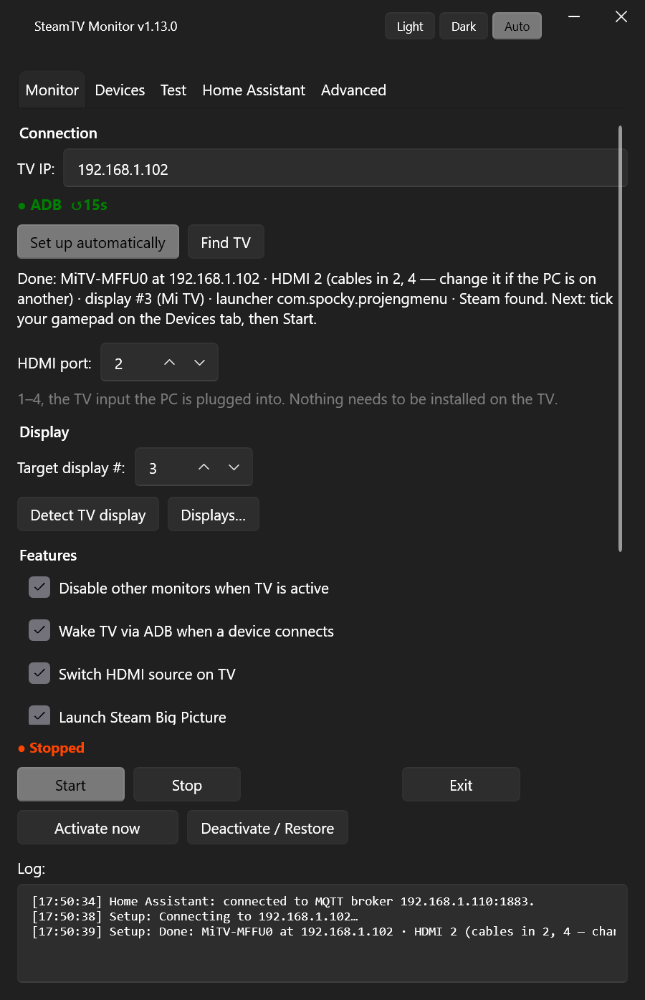

# SteamTV

[](https://github.com/AirwarQQ/SteamTV/releases/latest)


[](LICENSE)

**Pick up the controller — the TV is already showing Steam.**

Turn on your gamepad: the TV wakes up, switches to the PC's HDMI input, and Steam Big Picture opens on it. Close Big Picture: your desk monitors come back exactly as they were and the TV goes back to its home screen. No remote, no Win+P, no walking to the PC.

<p align="center">
  
  &nbsp;
  
</p>

## Features

- 🎮 **Any controller is the "on" button** — Xbox, DualSense/DualShock, Switch Pro, 8BitDo, Flydigi… USB or Bluetooth. Even a keyboard or any other device can be a trigger.
- 📺 **Takes over the TV** — wakes it and switches it to the PC's HDMI input over ADB (Wi-Fi), then checks the switch actually happened and rolls back if it didn't.
- 🖥️ **Handles the monitors** — turns the TV display on in Windows, optionally switches every other monitor off, sets the highest refresh rate, and later restores the **exact** previous layout (positions, primary display, everything).
- 🚀 **Steam Big Picture** opens on the TV, and closing it ends the session. Or end it when the controller switches off — with a 10 s grace period for Bluetooth hiccups.
- ⚙️ **Per-device behaviour** — your own names, "TV + Big Picture" or "TV only" (e.g. a keyboard to use the desktop on the TV), restore on disconnect.
- 🔌 **Bridge apps work too** — controllers connected through Switch2Connect (Switch 2 Pro Controller via an ESP32), DS4Windows and similar are picked up as virtual gamepads.
- 🏠 **Home Assistant** (optional, over MQTT) — a SteamTV device with "Gamepad monitoring" and "Steam on TV" switches, for dashboards, automations and voice assistants.
- 🛠️ **TV setup from the app** — install the bundled HDMI1/2/3 helpers over ADB and automatically find the TV's default launcher.
- ⌨️ **Global keyboard shortcuts** — assign your own Activate and Deactivate combinations; they work while SteamTV is in the tray.
- 🪶 **Lives in the tray** — starts with Windows, reacts instantly to devices, notifies you only when something goes wrong, checks for updates. Light/dark theme.

## Why SteamTV

- **No HDMI-CEC needed.** Most PC GPUs don't do CEC at all; SteamTV talks to the TV over ADB instead, so it works with Android / Google TVs.
- **Your desk setup survives.** Multi-monitor layouts are snapshotted before and restored after — not just "extend/duplicate" guesses.
- **One file, nothing to install.** A single `SteamTV.exe`; `adb.exe` is bundled. Settings live in your user registry.
- **Hands off by default.** Once set up, you never open it: controller on → play, Big Picture off → back to work.

---

## How it works

1. **A trigger device connects** (USB or Bluetooth) → wake the TV over ADB, turn on the TV display in Windows (optionally turning the other monitors off), switch the TV's HDMI input to the PC, launch Steam Big Picture.
2. **Big Picture closes** — or, if you choose, **the device disconnects** → restore the monitor layout, send the TV back to its home screen, minimize Steam.

---

## Requirements

| | |
|---|---|
| **Windows 10 / 11** | .NET Framework 4.8 is already built in (Windows 10 1903+). |
| **Android TV with ADB** | *Developer options → USB debugging* (or *Wireless debugging*) enabled — see [Setup](#2-enable-adb-on-the-tv). `adb.exe` itself is bundled, nothing to install on the PC. |
| **TV External Source app** | HDMI1/2/3 helpers are bundled: install them from the Monitor tab over ADB. HDMI4 requires its own helper, installed separately. |
| **Steam** | Default install path, or set yours on the Advanced tab. |

---

## Setup

### 1. Download
Grab `SteamTV-vX.Y.Z-win.zip` from the [latest release](https://github.com/AirwarQQ/SteamTV/releases/latest), extract it anywhere and run `SteamTV.exe`. It's a single file — on first run it unpacks `adb.exe` next to itself.

### 2. Enable ADB on the TV
- **Settings → Device Preferences → About → Build number** — tap it 7 times to unlock Developer options.
- In **Developer options**, turn on **USB debugging** (ADB).
- Note the TV's IP address from **Settings → Network**.

### 3. Set up the Monitor tab

| Field | What to enter |
|---|---|
| **TV IP** | The TV's IP address. The indicator under it turns green once ADB reaches the TV (checked every 15 s). |
| **HDMI port** | Which HDMI input (1–4) the PC is plugged into. |
| **Target display #** | The TV's display number in Windows — **Displays…** lists them. |

Click **Start**. The first time, the TV shows an "Allow USB debugging?" prompt — accept it (tick *Always allow*).

### 4. Pick your trigger devices
For a new TV, first click **Install HDMI1 / HDMI2 / HDMI3 on TV** on the Monitor tab. SteamTV installs the bundled APKs over ADB, skips existing packages and reports errors in the log. Accept the debugging prompt on the TV if needed, then retry. No download is required. This installs shortcuts; it does not detect which HDMI port your PC uses.

On **Advanced → TV integration**, click **Find TV launcher** to detect and save the TV's default Home app. If Android has no default launcher, select one on the TV first or enter the component manually.

On the **Devices** tab, find your controller in the bottom list, select it and click **↑ Add** (or double-click it). Make sure its **On** box is ticked. That's it — switch the controller on and the TV should follow. More on this tab [below](#devices).

### 5. Autostart (optional)
Tick **Run at Windows startup (hidden in tray)** on the Monitor tab. SteamTV then starts silently in the tray at login and begins monitoring on its own.

---

## Devices

**Bottom list — devices on this PC.** Every external USB and Bluetooth device Windows knows about (plus virtual gamepads created by bridge apps), with its real product name, a category (Gamepad, Keyboard, Mouse, Audio, Camera, Storage, Other), bus and live status. Click a header to sort, or filter by category. Paired Bluetooth devices stay listed while switched off (**Offline**), so a controller can be added even when it isn't on. Built-in hardware and USB hubs are hidden.

**Top list — trigger devices.** Only devices with **On** ticked trigger anything. Select one to change its settings:

| Setting | What it does |
|---|---|
| **Name** | Your own name for it (e.g. *Living-room pad*), used in the list and the log. Empty = product name. |
| **On connect** | **TV + Big Picture** — the full sequence. **TV only** — wake the TV and switch displays/input, but don't open Big Picture (e.g. a keyboard for using the desktop on the TV). |
| **Restore monitors when it disconnects** | When the device has been gone for 10 s: close Big Picture if open, restore the monitors, send the TV home. The 10 s grace rides out brief Bluetooth dropouts — reconnecting in time cancels it. A natural pair for **TV only**, which has no Big Picture to close. |

A few details worth knowing:
- Activation happens when a ticked device **connects**, not while it stays connected — so a keyboard that's always plugged in never blocks a gamepad from triggering.
- While the TV is already active, another trigger device connecting doesn't start a second activation.
- Devices are picked up the moment Windows reports them, with a 2-second poll as a backup.

---

## Monitor tab

**Features** — switch off any step you don't want:

| Toggle | Effect |
|---|---|
| Disable other monitors when TV is active | Only the TV stays on while it's in use; the full layout comes back afterwards. |
| Wake TV via ADB when a device connects | Sends a power key press if the TV screen is off. |
| Switch HDMI source on TV | Switches the TV to the PC's HDMI input through the TV External Source app. |
| Launch Steam Big Picture | Opens Big Picture once the TV is on the right input. |

**Activate now** / **Deactivate / Restore** run the same sequences by hand — useful for testing, and as a one-click way back if something got out of sync. The **Test** tab has buttons for each individual step (wake TV, switch input, list/enable/disable displays, …).

### Tray
Closing or minimizing the window keeps SteamTV running in the tray. The icon is **green** when ADB reaches the TV and **red** when it doesn't; right-click shows the current ADB and monitoring status. A tray notification pops up when something needs your attention — the TV didn't switch input, Big Picture failed to start, monitors couldn't be restored, ADB unreachable for a while during monitoring — and when a new version is out.

The light / dark / auto theme switch sits in the title bar.

---

## Advanced tab

| Setting | Default |
|---|---|
| **adb.exe path** | The bundled copy next to `SteamTV.exe`. Point it at your own `platform-tools` install if you prefer. |
| **steam.exe path** | `C:\Program Files (x86)\Steam\steam.exe` |
| **HDMI activity pattern** | Xiaomi / MiTV default; other TVs may need a different pattern — see below. |
| **TV home component** | Click **Find TV launcher** to detect the TV's default Home app, or enter its component manually. |

### Global keyboard shortcuts
Click the **Activate now** or **Deactivate / Restore** shortcut field, then press your preferred combination with Ctrl, Alt or Win. Click **Save shortcuts** to apply and persist it. Shortcuts work even with SteamTV hidden in the tray or monitoring stopped, and perform the same actions as the corresponding buttons. They are disabled by default. Press Escape in a field and save to disable that shortcut.

SteamTV rejects duplicate combinations and reports shortcuts Windows cannot register (for example, those already used by another app). If registration fails, it attempts to restore the previous shortcuts. At startup, any registration error appears in the settings and log.

### Values for a non-Xiaomi TV
Use automatic launcher detection first. To find the HDMI activity pattern (or a launcher manually), connect to the TV (`adb connect <TV_IP>` from the folder with `adb.exe`) and inspect the foreground activity:

```
adb shell dumpsys activity activities | findstr ResumedActivity
```

1. **HDMI activity pattern** — switch the TV to the PC's input with the remote, run the command, take the `package/.Activity` part (e.g. `com.example.tvplayer/.ExternalSourceActivity`) and escape the dots: `com\.example\.tvplayer/\.ExternalSourceActivity`.
2. **TV home component** — click **Find TV launcher** for automatic detection. Alternatively, go back to the TV's home screen, run the command again, and paste the `package/.Activity` as-is (e.g. `com.example.launcher/.MainActivity`).

All settings live in the registry under `HKCU\Software\SteamTV`.

---

## Home Assistant

Optional — SteamTV can show up in Home Assistant as a device you can see and switch from a dashboard, an automation or a voice assistant. It talks MQTT, so you need a broker (the **Mosquitto broker** add-on, or any other) and the **MQTT** integration set up in Home Assistant.

1. On the **Advanced** tab, under **Home Assistant (MQTT)**, enter the broker's **Host**, **Port** (1883 by default), **Login** and **Password** (an HA user works with the Mosquitto add-on).
2. **Test** checks that the broker accepts the connection and the login — it doesn't change anything.
3. Tick **Connect to Home Assistant through an MQTT broker**. After editing the fields later, click **Save & reconnect**.

<p align="center"></p>

A **SteamTV** device appears in Home Assistant by itself (MQTT discovery), with two switches:

| Switch | On | Off |
|---|---|---|
| **Gamepad monitoring** | Same as **Start** | Same as **Stop** |
| **Steam on TV** | Same as **Activate now** | Same as **Deactivate / Restore** |

- Both report the real state, including changes SteamTV makes on its own — a gamepad switching the TV on, Big Picture closing.
- When SteamTV exits, or the PC goes to sleep or drops off the network, the device shows as **unavailable**.
- SteamTV reconnects by itself if the broker restarts or the network goes away for a while.
- Every command from Home Assistant is written to the log (`Home Assistant command: …`).
- The password is stored encrypted for your Windows account (DPAPI).
- Unticked, SteamTV makes no network connections for this at all.

<details>
<summary>MQTT topics</summary>

`<id>` is the PC's name, lowercased (e.g. `livingroom-pc`).

| Topic | |
|---|---|
| `steamtv/<id>/availability` | `online` / `offline` (retained; `offline` is also the last will) |
| `steamtv/<id>/monitoring/state`, `steamtv/<id>/steam_on_tv/state` | `ON` / `OFF` (retained) |
| `steamtv/<id>/monitoring/set`, `steamtv/<id>/steam_on_tv/set` | send `ON` / `OFF` |
| `homeassistant/switch/steamtv_<id>/<switch>/config` | discovery (retained) |

Discovery and states are published again whenever Home Assistant restarts (`homeassistant/status` = `online`).
</details>

---

## Troubleshooting

**ADB indicator / tray icon is red**
- Check the TV IP and that the TV is on the same network.
- Make sure the TV accepted the debugging prompt. Missed or declined it? Use **Revoke USB debugging authorisations** in Developer options, then click **Start** again to get a fresh prompt.
- Many Android TVs **switch Wireless debugging off by themselves** after a reboot or update. Nothing on the PC side can turn it back on — re-enable it on the TV, or install [adb-auto-enable](https://github.com/mouldybread/adb-auto-enable) **on the TV** to have it re-enabled at every boot.

**TV didn't switch to the PC ("rolled back")**
- Usually the HDMI activity pattern doesn't match your TV — see [Values for a non-Xiaomi TV](#values-for-a-non-xiaomi-tv).

**Wrong display turned on**
- Use **Displays…** to find the TV's number; it matches `\\.\DISPLAYn` in Windows display settings.

**Device not in the list**
- Bluetooth devices have to be paired in Windows first.
- Built-in devices (laptop keyboard, internal webcam, Bluetooth radio) and USB hubs are deliberately hidden.
- Gamepads are recognized by their HID gamepad/joystick type, Xbox controllers by their own interface. Anything unrecognized still appears — under **Other** — and works as a trigger all the same.

**Controller connected through a bridge app (Switch2Connect, DS4Windows…)**
- Such apps hand Windows a *virtual* gamepad that only exists while the real controller is connected. It shows up as **Virtual gamepad (…)** with bus **Virtual** — add that one, not the USB adapter (an ESP32 or other dongle is powered all the time and always reads as connected).
- The virtual pad's identity depends on the app's emulation mode (Xbox, PS4, PS5…). After switching modes, add it again.

---

## Building from source

```
dotnet build -c Release
```

Produces a single self-contained `bin\Release\net48\SteamTV.exe` — WPF-UI is merged in by Costura.Fody and `adb.exe` is embedded as a resource. Visual Studio 2022+ works too.

```
SteamTV/
├─ App.xaml(.cs)            entry point: single instance, -autostart flag, theme
├─ MainWindow.xaml(.cs)     UI: Monitor / Devices / Test / Advanced tabs, tray icon
├─ Appsettings.cs           registry-backed settings, WatchedDevice model
├─ app.manifest             per-monitor DPI awareness
├─ Interop/Native.cs        P/Invoke: CCD display API, device-change notifications
├─ Services/
│  ├─ Monitorservice.cs     the main loop: trigger devices + Big Picture → activate / restore
│  ├─ DeviceScanner.cs      external USB/Bluetooth devices via cfgmgr32
│  ├─ Displaymanager.cs     enable / disable / restore monitors (SetDisplayConfig)
│  ├─ Adb.cs, AdbBundle.cs  adb wrapper; unpacking the bundled adb.exe
│  ├─ Steamhelper.cs        Big Picture: detect, launch, close; minimize Steam
│  └─ UpdateChecker.cs      new-release check on startup
└─ Vendor/adb.exe           Android Platform Tools (Apache 2.0, see adb-NOTICE.txt)
```

UI built with [WPF-UI](https://github.com/lepoco/wpfui). Licensed under MIT — see [LICENSE](LICENSE).
