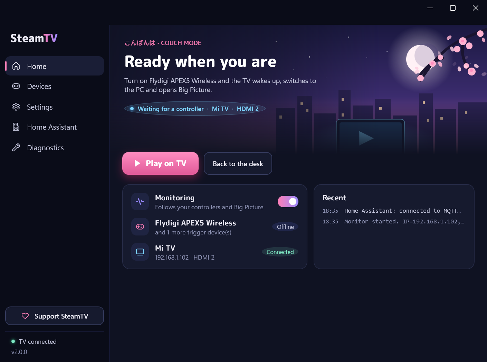
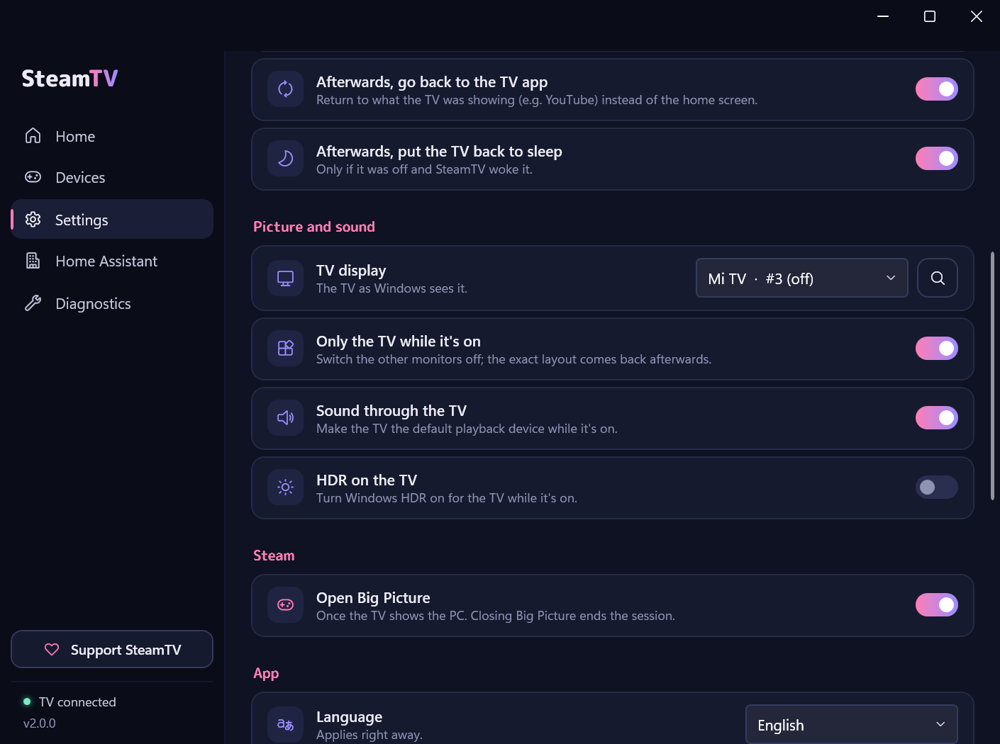
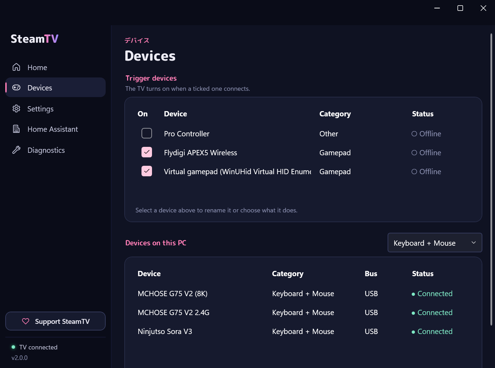
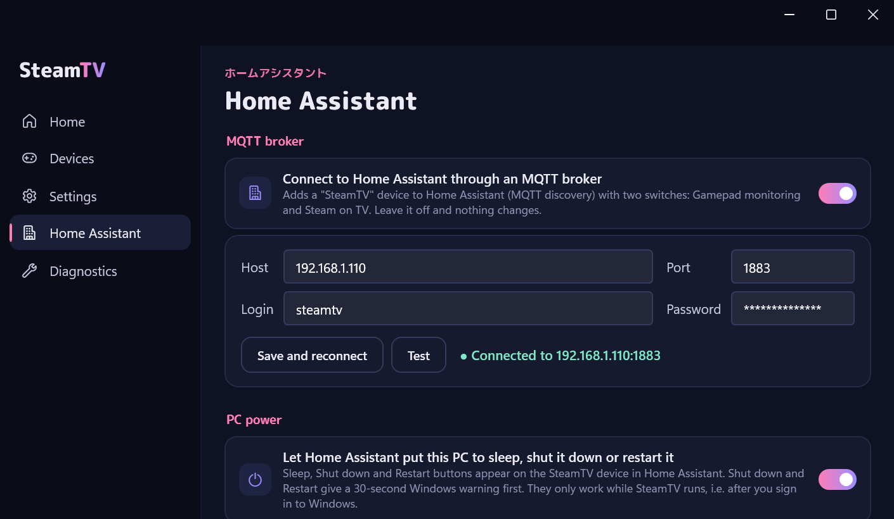

# SteamTV

[](https://github.com/AirwarQQ/SteamTV/releases/latest)


[](LICENSE)
[](https://boosty.to/airwaruwu/donate)

**Pick up the controller — the TV is already showing Steam.**

Turn on your gamepad: the TV wakes up, switches to the PC's HDMI input, sound moves to the TV and Steam Big Picture opens on it. Close Big Picture: your desk monitors and speakers come back exactly as they were, and the TV goes back to whatever it was showing. No remote, no Win+P, no walking to the PC.

<p align="center">
  
</p>
<p align="center">
  
  &nbsp;
  
</p>

## Features

- 🎮 **Any controller is the "on" button** — Xbox, DualSense/DualShock, Switch Pro, 8BitDo, Flydigi… USB or Bluetooth. Even a keyboard or any other device can be a trigger.
- 🪄 **Sets itself up** — on first launch it finds the TV on your network, connects, and fills in the HDMI port, the TV display, the TV's launcher and the Steam path. No IP addresses or ADB commands to look up.
- 📺 **Takes over the TV** — wakes it (Wake-on-LAN too, if it's in deep sleep) and switches it to the PC's HDMI input over ADB (Wi-Fi), then checks the switch actually happened and rolls back if it didn't. Afterwards it returns the TV to the app it was showing and, if SteamTV woke it, puts it back to sleep. A new IP from the router is picked up by itself.
- 🔊 **Sound and HDR follow the TV** — the TV becomes the default playback device while it's on (and optionally HDR is switched on); both go back afterwards.
- 🖥️ **Handles the monitors** — turns the TV display on in Windows, optionally switches every other monitor off, sets the highest refresh rate, and later restores the **exact** previous layout (positions, primary display, everything).
- 🚀 **Steam Big Picture** opens on the TV, and closing it ends the session. Or end it when the controller switches off — with a 10 s grace period for Bluetooth hiccups.
- ⚙️ **Per-device behaviour** — your own names, "TV + Big Picture" or "TV only" (e.g. a keyboard to use the desktop on the TV), back to the desk on disconnect.
- 🔌 **Bridge apps work too** — controllers connected through Switch2Connect (Switch 2 Pro Controller via an ESP32), DS4Windows and similar are picked up as virtual gamepads.
- 🏠 **Home Assistant** (optional, over MQTT) — a SteamTV device with "Gamepad monitoring" and "Steam on TV" switches, plus optional Sleep / Shut down / Restart buttons, for dashboards, automations and voice assistants.
- 🛠️ **Nothing to install on the TV** — the HDMI input is switched with the TV's own components.
- ⌨️ **Global keyboard shortcuts** — Ctrl+Alt+9 / Ctrl+Alt+0 out of the box, or your own; they work while SteamTV is in the tray.
- 🌙 **A cozy look** — a calm night palette with a softly animated sakura scene on the Home page (it pauses whenever the window isn't on screen). English and Russian, switchable on the fly.
- 🪶 **Lives in the tray** — starts with Windows, reacts instantly to devices, Play on TV / Back to the desk right from the tray menu, notifies you only when something goes wrong, updates itself in one click, keeps a log file.

## Why SteamTV

- **No HDMI-CEC needed.** Most PC GPUs don't do CEC at all; SteamTV talks to the TV over ADB instead, so it works with Android / Google TVs.
- **Your desk setup survives.** Multi-monitor layouts are snapshotted before and restored after — not just "extend/duplicate" guesses.
- **One file, nothing to install.** A single `SteamTV.exe`; `adb.exe` is bundled and unpacked to `%LOCALAPPDATA%\SteamTV`. Settings live in your user registry.
- **Hands off by default.** Once set up, you never open it: controller on → play, Big Picture off → back to work.

---

## How it works

1. **A trigger device connects** (USB or Bluetooth) → wake the TV over ADB, turn on the TV display in Windows (optionally turning the other monitors off), switch the TV's HDMI input to the PC, move the sound to the TV, launch Steam Big Picture.
2. **Big Picture closes** — or, if you choose, **the device disconnects** → restore the monitor layout and the sound device, return the TV to what it was showing (and back to sleep if SteamTV woke it), minimize Steam.

---

## Requirements

| | |
|---|---|
| **Windows 10 / 11** | .NET Framework 4.8 is already built in (Windows 10 1903+). |
| **Android TV with ADB** | *Developer options → USB debugging* (or network / wireless debugging) enabled — see [Setup](#2-enable-adb-on-the-tv). `adb.exe` itself is bundled, nothing to install on the PC. |
| **Steam** | Found by itself; set another path in Settings → Advanced if needed. |

---

## Setup

### 1. Download
Grab `SteamTV-vX.Y.Z-win.zip` from the [latest release](https://github.com/AirwarQQ/SteamTV/releases/latest), extract it anywhere and run `SteamTV.exe`. It's a single file — on first run it unpacks `adb.exe` to `%LOCALAPPDATA%\SteamTV`.

### 2. Enable ADB on the TV
- **Settings → Device Preferences → About → Build number** — tap it 7 times to unlock Developer options.
- In **Developer options**, turn on **USB debugging** (ADB) — on some TVs it's called network or wireless debugging.

### 3. Let SteamTV set itself up
On first launch SteamTV runs **Set up automatically** by itself (it's also on the Home page while no TV is set, and at the top of **Settings**):
1. It looks for Android TVs on your network. If it finds several, pick yours in the list under **Set up automatically** and click **Set up** again.
2. The TV shows **"Allow USB debugging?"** — accept it and tick *Always allow*. SteamTV waits up to a minute for that.
3. It fills in the **HDMI input** (from the inputs the TV reports a cable in — check it if several are connected), the **TV display** (by its name in Windows), the TV's **launcher** and the **Steam** path.

Everything stays editable in **Settings**: the TV address, the HDMI input and the TV display (listed by name; the 🔍 button picks the one that looks like a TV). The line under the address turns green once ADB reaches the TV (checked every 15 s).

### 4. Pick your trigger devices
On the **Devices** page, find your controller in the bottom list, select it and click **Add** (or double-click it). Make sure its **On** box is ticked. That's it — switch the controller on and the TV should follow. More on this page [below](#devices).

### 5. Autostart (optional)
Turn on **Start with Windows** in Settings → App. SteamTV then starts silently in the tray at login and, with **Monitor right away** on, begins monitoring on its own.

---

## Home

The status banner says what SteamTV is doing — waiting for a controller, TV on, or monitoring paused — with the TV and its HDMI input. Below it:

- **Play on TV** runs the whole sequence by hand, without waiting for a controller.
- **Back to the desk** closes Big Picture and brings the monitors, the sound and the TV back — also a one-click fix if things got out of sync.
- **Monitoring** turns the automatic reaction to controllers and Big Picture on or off.
- The trigger device and the TV with their live state, and the most recent events.

The same actions are in the tray menu and on the keyboard shortcuts.

---

## Devices

**Bottom list — devices on this PC.** Every external USB and Bluetooth device Windows knows about (plus virtual gamepads created by bridge apps), with its real product name, a category (Gamepad, Keyboard, Mouse, Audio, Camera, Storage, Other), bus and live status. Click a header to sort, or filter by category. Paired Bluetooth devices stay listed while switched off (**Offline**), so a controller can be added even when it isn't on. Built-in hardware and USB hubs are hidden.

**Top list — trigger devices.** Only devices with **On** ticked trigger anything. Select one to change its settings:

| Setting | What it does |
|---|---|
| **Name** | Your own name for it (e.g. *Living-room pad*), used in the list, on Home and in the log. Empty = product name. |
| **On connect** | **TV + Big Picture** — the full sequence. **TV only** — wake the TV and switch displays/input, but don't open Big Picture (e.g. a keyboard for using the desktop on the TV). |
| **Back to the desk when it disconnects** | When the device has been gone for 10 s: close Big Picture if open, restore the monitors, return the TV. The 10 s grace rides out brief Bluetooth dropouts — reconnecting in time cancels it. A natural pair for **TV only**, which has no Big Picture to close. |

A few details worth knowing:
- Activation happens when a ticked device **connects**, not while it stays connected — so a keyboard that's always plugged in never blocks a gamepad from triggering.
- While the TV is already on, another trigger device connecting doesn't start a second activation.
- Devices are picked up the moment Windows reports them, with a 2-second poll as a backup.

---

## Settings

Changes apply right away — there's no Save button, and nothing is locked while monitoring runs.

| Setting | Effect |
|---|---|
| **TV address**, **HDMI input** | Filled in by Set up automatically. |
| **Wake the TV** | Turns the TV screen on if it's off — and sends Wake-on-LAN first if the TV is in deep sleep and doesn't answer. |
| **Switch the TV to the PC** | Selects the PC's HDMI input — nothing needs to be installed on the TV, see [How the HDMI input is switched](#how-the-hdmi-input-is-switched). |
| **Afterwards, go back to the TV app** | Instead of the home screen — e.g. back to YouTube where you left it. |
| **Afterwards, put the TV back to sleep** | If the TV was off before, it goes off again when you're done. |
| **TV display** | The TV as Windows sees it, listed by name. |
| **Only the TV while it's on** | Switches the other monitors off; the full layout comes back afterwards. |
| **Sound through the TV** | Makes the TV's HDMI audio the default playback device and puts the previous one back afterwards. On by default. |
| **HDR on the TV** | Switches Windows HDR on for the TV display, and back afterwards. Off by default. |
| **Open Big Picture** | Once the TV is on the right input. Closing Big Picture ends the session. |
| **Language** | Same as Windows, English or Russian. Applies right away. |
| **Start with Windows**, **Monitor right away** | Start hidden in the tray; turn monitoring on at start. |

### Keyboard shortcuts
Click the **Play on TV** or **Back to desk** field, then press your combination with Ctrl, Alt or Win, and click **Save shortcuts**. Shortcuts work even with SteamTV hidden in the tray or monitoring off. Defaults: **Ctrl+Alt+9** and **Ctrl+Alt+0**. Press Escape in a field and save to disable that shortcut. SteamTV rejects duplicate combinations; if another app already uses one, a tray notification says so at startup and the other shortcut still works.

### Advanced
Collapsed at the bottom of Settings — normally filled in by themselves:

| Setting | Default |
|---|---|
| **TV launcher** | Blank = the TV's Home key. **Find** detects the default Home app, or enter its `package/.Activity` manually. |
| **TV sound device** | Blank = the playback device named after the TV display (e.g. *Mi TV (NVIDIA High Definition Audio)*). Enter part of another device's name to override. |
| **steam.exe** | Where Steam says it's installed. |
| **adb.exe** | `adb.exe` = the bundled copy in `%LOCALAPPDATA%\SteamTV`. Point it at your own `platform-tools` install if you prefer. |

### How the HDMI input is switched
Nothing is installed on the TV. SteamTV tries, in order:
1. **Xiaomi / MiTV** — the TV's own player (`com.xiaomi.mitv.tvplayer`), told which HDMI port to open.
2. **Any Android TV** — the standard passthrough intent for the HDMI input listed by `dumpsys tv_input`.
3. **TV External Source app** (liskovsoft `hdmiN`) — only if it's already installed, as a last resort.

It then waits for the screen that method opens to come to the front; if it doesn't within 10 s, it rolls back.

### Manual values
To find a launcher by hand (or an HDMI activity pattern override), connect to the TV (`adb connect <TV_IP>` from the folder with `adb.exe`) and inspect the foreground activity:

```
adb shell dumpsys activity activities | findstr ResumedActivity
```

1. **TV launcher** — go to the TV's home screen, run the command, and paste the `package/.Activity` as-is (e.g. `com.example.launcher/.MainActivity`).
2. **HDMI activity pattern** — not in the UI; needed only if the TV does switch but SteamTV still rolls back. Switch the TV to the PC's input with the remote, run the command, escape the dots of the `package/.Activity` part (`com\.example\.tvplayer/\.ExternalSourceActivity`) and store it as the `HdmiActivityPattern` string value in the registry key below.

All settings live in the registry under `HKCU\Software\SteamTV`.

---

## Tray

Closing or minimizing the window keeps SteamTV running in the tray. The icon's dot is **mint** when ADB reaches the TV and **red** when it doesn't. Right-click for the current state, **Play on TV**, **Back to the desk**, **Monitoring**, autostart options, the log file and Exit.

A tray notification pops up when something needs your attention — the TV didn't switch input, Big Picture failed to start, monitors couldn't be restored, ADB unreachable for a while during monitoring — and when a new version is out: click the notification (or **Install update** in the tray menu) and SteamTV downloads it, swaps the exe and restarts. **Open log file** opens `%LOCALAPPDATA%\SteamTV\steamtv.log`, which keeps the log across restarts. Starting `SteamTV.exe` again while it's in the tray brings its window up.

The **Diagnostics** page has a button for each individual step (wake TV, switch input, list/enable/disable displays, sound devices, HDR, …) and the live log.

---

## Home Assistant

Optional — SteamTV can show up in Home Assistant as a device you can see and switch from a dashboard, an automation or a voice assistant. It talks MQTT, so you need a broker (the **Mosquitto broker** add-on, or any other) and the **MQTT** integration set up in Home Assistant.

1. On the **Home Assistant** page, enter the broker's **Host**, **Port** (1883 by default), **Login** and **Password** (an HA user works with the Mosquitto add-on).
2. **Test** checks that the broker accepts the connection and the login — it doesn't change anything.
3. Turn on **Connect to Home Assistant through an MQTT broker**. After editing the fields later, click **Save and reconnect**.

<p align="center"></p>

A **SteamTV** device appears in Home Assistant by itself (MQTT discovery), with two switches:

| Switch | On | Off |
|---|---|---|
| **Gamepad monitoring** | Same as the **Monitoring** toggle on | Monitoring off |
| **Steam on TV** | Same as **Play on TV** | Same as **Back to the desk** |

- Both report the real state, including changes SteamTV makes on its own — a gamepad switching the TV on, Big Picture closing.
- When SteamTV exits, or the PC goes to sleep or drops off the network, the device shows as **unavailable**.
- SteamTV reconnects by itself if the broker restarts or the network goes away for a while.
- Every command from Home Assistant is written to the log (`Home Assistant command: …`).
- The password is stored encrypted for your Windows account (DPAPI).
- Turned off, SteamTV makes no network connections for this at all.

### PC power
Turn on **Let Home Assistant put this PC to sleep, shut it down or restart it** and the device also gets **Sleep**, **Shut down** and **Restart** buttons. This replaces the usual SSH-into-Windows `shell_command` setup: no OpenSSH server on the PC, no keys or YAML in Home Assistant, and the buttons come back by themselves after a Home Assistant reinstall.

- **Shut down** and **Restart** show Windows' own 30-second warning first; `shutdown /a` cancels it.
- The buttons only work while SteamTV runs, i.e. after you've signed in to Windows.
- Turned off, the buttons disappear from Home Assistant and power commands are ignored.

**Switching on** can't come from SteamTV, since the PC is off at that point. Add the **Wake on LAN** integration in Home Assistant (Settings → Devices & services → Add integration) with the MAC address shown on the page, and enable Wake on LAN in the BIOS / network adapter settings. To get a single on/off switch, add a **Template → Switch** helper: state from a **Ping** sensor for the PC, turn on → the Wake on LAN button, turn off → SteamTV's **Sleep** or **Shut down** button.

<details>
<summary>MQTT topics</summary>

`<id>` is the PC's name, lowercased (e.g. `livingroom-pc`).

| Topic | |
|---|---|
| `steamtv/<id>/availability` | `online` / `offline` (retained; `offline` is also the last will) |
| `steamtv/<id>/monitoring/state`, `steamtv/<id>/steam_on_tv/state` | `ON` / `OFF` (retained) |
| `steamtv/<id>/monitoring/set`, `steamtv/<id>/steam_on_tv/set` | send `ON` / `OFF` |
| `steamtv/<id>/sleep/set`, `steamtv/<id>/shutdown/set`, `steamtv/<id>/restart/set` | send `PRESS` (only with PC power on; retained messages are ignored) |
| `homeassistant/switch/steamtv_<id>/<switch>/config`, `homeassistant/button/steamtv_<id>/<button>/config` | discovery (retained) |

Discovery and states are published again whenever Home Assistant restarts (`homeassistant/status` = `online`).
</details>

---

## Troubleshooting

**"TV not reachable" / tray dot is red**
- Check the TV address and that the TV is on the same network.
- Make sure the TV accepted the debugging prompt. Missed or declined it? Use **Revoke USB debugging authorisations** in Developer options, then run **Set up** again to get a fresh prompt.
- Many Android TVs **switch Wireless debugging off by themselves** after a reboot or update. Nothing on the PC side can turn it back on — re-enable it on the TV, or install [adb-auto-enable](https://github.com/mouldybread/adb-auto-enable) **on the TV** to have it re-enabled at every boot.

**TV didn't switch to the PC ("rolled back")**
- Click **Switch HDMI Source** on the Diagnostics page — the log says which method was used, or why none worked.
- If the TV did switch but SteamTV still rolled back, set an HDMI activity pattern override — see [Manual values](#manual-values).

**Wrong display turned on**
- Pick the TV in Settings → **TV display**, or click 🔍 next to it; the number matches `\\.\DISPLAYn` in Windows display settings.

**Set up automatically finds no TV**
- The PC and the TV must be on the same network, and USB / network debugging must be on in the TV's Developer options. If the TV has no network debugging at all, enter its address by hand.
- Several Android devices found: pick the TV in the list under **Set up automatically**, then click **Set up** again.

**Sound stays on the PC**
- The TV's sound device only exists while its display is on. Check **List Sound Devices** on the Diagnostics page during a session — if the TV's device has an unusual name, enter part of it as **TV sound device** in Settings → Advanced.

**Device not in the list**
- Bluetooth devices have to be paired in Windows first.
- Built-in devices (laptop keyboard, internal webcam, Bluetooth radio) and USB hubs are deliberately hidden.
- Gamepads are recognized by their HID gamepad/joystick type, Xbox controllers by their own interface. Anything unrecognized still appears — under **Other** — and works as a trigger all the same.

**Controller connected through a bridge app (Switch2Connect, DS4Windows…)**
- Such apps hand Windows a *virtual* gamepad that only exists while the real controller is connected. It shows up as **Virtual gamepad (…)** with bus **Virtual** — add that one, not the USB adapter (an ESP32 or other dongle is powered all the time and always reads as connected).
- The virtual pad's identity depends on the app's emulation mode (Xbox, PS4, PS5…). After switching modes, add it again.

**Something else** — the tray menu's **Open log file** shows everything SteamTV did, also from before the last restart.

---

## Building from source

```
dotnet build -c Release
```

Produces a single self-contained `bin\Release\net48\SteamTV.exe` — WPF-UI is merged in by Costura.Fody, `adb.exe` is embedded as a resource. Visual Studio 2022+ works too.

```
SteamTV/
├─ App.xaml(.cs)            entry point: single instance (a second start shows the window), -autostart flag, theme
├─ Theme.xaml               the palette, fonts and control styles; re-points WPF-UI's brushes at the palette
├─ MainWindow.xaml(.cs)     the window: sidebar, Home / Devices / Settings / Home Assistant / Diagnostics pages, status, log
├─ MainWindow.*.cs          the rest of the window: AutoSetup, Devices, HomeAssistant, Tray, Setup (hotkeys, launcher)
├─ Controls/NightScene      the animated banner on Home
├─ Appsettings.cs           registry-backed settings, WatchedDevice model
├─ Fonts/                   Rounded M+ 1c, subset to Latin, Cyrillic and kana (OFL)
├─ app.manifest             per-monitor DPI awareness
├─ Interop/Native.cs        P/Invoke: CCD display API, device-change notifications
├─ Services/
│  ├─ Monitorservice.cs     the main loop: trigger devices + Big Picture → activate / restore
│  ├─ DeviceScanner.cs      external USB/Bluetooth devices via cfgmgr32
│  ├─ Displaymanager.cs     enable / disable / restore monitors (SetDisplayConfig), TV detection, HDR
│  ├─ Adb.cs, AdbBundle.cs  adb wrapper (wake, HDMI switch, return/sleep); the bundled adb.exe
│  ├─ TvDiscovery.cs        finding the TV on the network, its MAC, Wake-on-LAN
│  ├─ AudioSwitcher.cs      default playback device (Core Audio / IPolicyConfig)
│  ├─ Steamhelper.cs        Big Picture: detect, launch, close; minimize Steam; find steam.exe
│  ├─ HomeAssistantMqtt.cs  MQTT discovery, switch states, commands from Home Assistant
│  ├─ PowerControl.cs       sleep / shut down / restart, MAC for Wake on LAN
│  ├─ GlobalHotkeys.cs      Play on TV / Back to the desk shortcuts
│  ├─ Loc.cs                English and Russian UI text ({l:Tr Key} in XAML)
│  ├─ UpdateChecker.cs, Updater.cs  new-release check; download, swap the exe, restart
│  └─ AppLog.cs             log file in %LOCALAPPDATA%\SteamTV
└─ Vendor/adb.exe           Android Platform Tools (Apache 2.0, see adb-NOTICE.txt)
```

## Support

SteamTV is free and stays free. If it makes your evenings on the couch nicer, you can buy the author a coffee on **[Boosty](https://boosty.to/airwaruwu/donate)** — it's also behind the ♥ button in the app and the tray menu.

---

UI built with [WPF-UI](https://github.com/lepoco/wpfui); headings in [M PLUS Rounded 1c](https://github.com/coz-m/MPLUS_FONTS) (SIL Open Font License, see `Fonts/OFL.txt`). The Home banner is original artwork. SteamTV is licensed under MIT — see [LICENSE](LICENSE).
