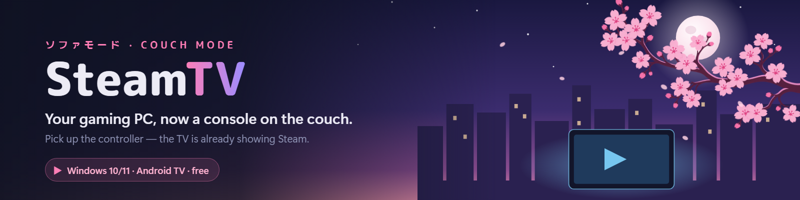
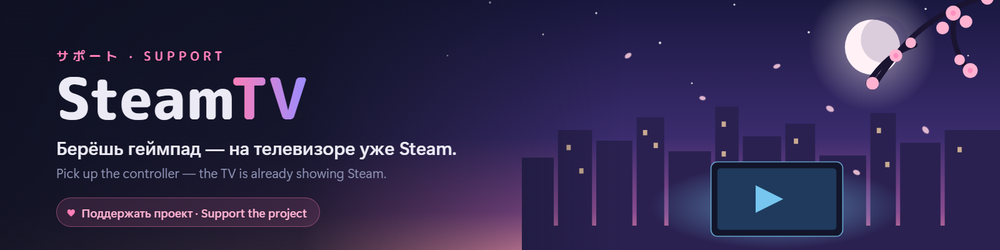

  

  
  
  
  
  

**Not sold on the Steam Machine's specs — or its price? Your gaming PC already is one.**

SteamTV turns the PC you have into a living-room console: pick up the controller and the TV wakes up, switches to the PC, the sound moves over and Steam Big Picture opens. Close Big Picture and your desk is back exactly as you left it — monitors, speakers, even the app the TV was showing. No second box, no remote, no Win+P, no walking to the PC.

  

## What it does

- 🎮 **Any controller is the "on" button** — Xbox, DualSense, Switch Pro, 8BitDo, Flydigi…, USB or Bluetooth, also through DS4Windows or Switch2Connect.
- 🪄 **Sets itself up** — finds the TV on your network and fills in the HDMI input, the TV display and Steam. No IP addresses or ADB commands to look up, nothing to install on the TV.
- 📺 **Takes over the TV** — wakes it (Wake-on-LAN too), switches the input, checks it really switched; afterwards returns it to what it showed and back to sleep if it was off.
- 🖥️ **Your desk survives** — optionally only the TV stays on while you play; the exact monitor layout, refresh rate and sound device come back afterwards.
- ⌨️ **Shortcuts and tray** — Ctrl+Alt+9 / Ctrl+Alt+0 (or one key for both), Play on TV / Back to PC from the tray.
- 🏠 **Home Assistant** (optional) — switches for dashboards and voice assistants, plus Sleep / Shut down / Restart for the PC.
- 🌙 **Cozy and quiet** — a calm night theme with an animated sakura scene (one switch turns the animation off), English and Russian, checks for updates daily and installs them in a click, lives in the tray.

## Quick start

1. **Download** `SteamTV-vX.Y.Z-win.zip` from the [latest release](https://github.com/AirwarQQ/SteamTV/releases/latest), extract it anywhere, run `SteamTV.exe`.
2. **On the TV**, enable *Developer options* (Settings → Device Preferences → About → tap *Build number* 7 times) and turn on **USB / network debugging**.
3. SteamTV **sets itself up** on first launch. When the TV asks *"Allow USB debugging?"*, accept and tick *Always allow*.
4. On the **Devices** page, add your controller. Switch it on — the TV follows.

Turn on **Start with Windows** in Settings and you'll never need to open it again.

  
  &nbsp;
  

## Tips

- **Keep the TV display switched off in Windows** (Settings → System → Display → *Disconnect this display*). SteamTV turns it on when you play and off again afterwards, so it never gets in the way at the desk.
- **Only the TV while it's on** is worth turning on: with the other monitors off, games started from Big Picture open on the TV instead of on a desk monitor.
- **TV far from the PC?** An optical (fiber) HDMI cable works over 15–20 m without a hitch — the author's setup runs on one.
- **Network debugging turns itself off** on many TVs after a reboot. On the author's TV, **tvQuickActions** keeps it on; [adb-auto-enable](https://github.com/mouldybread/adb-auto-enable) and [KeepADB](https://f-droid.org/packages/de.hohnepeople.keepadb/) do the same job.
- **When a controller disconnects** SteamTV can go back to the PC by itself — turn it on per device on the Devices page; how long it waits is in Settings.

## How it works

1. **A trigger device connects** → wake the TV over ADB (Wi-Fi), turn on the TV display, switch the TV's HDMI input, move the sound, open Big Picture.
2. **Big Picture closes** (or the controller has been gone for a while) → restore the monitors and sound, return the TV, minimize Steam.

No HDMI-CEC needed — most PC graphics cards don't do it anyway. SteamTV talks to the TV over ADB, so it works with Android / Google TVs. Xiaomi TVs are switched with their own player; other Android TVs with the standard TV-input intent.

## Home Assistant

Optional. On the **Home Assistant** page, enter your MQTT broker (e.g. the Mosquitto add-on) and turn it on. A **SteamTV** device appears by itself with two switches — **Gamepad monitoring** and **Steam on TV** — and, if you allow it, **Sleep**, **Shut down** and **Restart** buttons for the PC. Switching the PC *on* is Home Assistant's Wake on LAN integration; the page shows the MAC to use.

MQTT topics

`<id>` is the PC's name, lowercased.

| Topic | |
|---|---|
| `steamtv/<id>/availability` | `online` / `offline` (retained, last will) |
| `steamtv/<id>/monitoring/state`, `…/steam_on_tv/state` | `ON` / `OFF` (retained) |
| `steamtv/<id>/monitoring/set`, `…/steam_on_tv/set` | send `ON` / `OFF` |
| `steamtv/<id>/sleep/set`, `…/shutdown/set`, `…/restart/set` | send `PRESS` (with PC power allowed) |

Discovery is published again whenever Home Assistant restarts.

## Troubleshooting

- **"TV not reachable"** — check the TV is on the same network and network debugging is still on (see Tips). Declined the prompt? *Revoke USB debugging authorisations* on the TV and run **Set up** again.
- **The TV didn't switch** — Diagnostics → **Switch HDMI Source** shows in the log which method was tried and why it failed.
- **Wrong display turned on** — pick the TV in Settings → **TV display**.
- **Sound stays on the PC** — Diagnostics → **List Sound Devices** while the TV is on; if its name is unusual, enter part of it in Settings → Advanced.
- **Controller missing** — pair Bluetooth devices in Windows first; with bridge apps add the **Virtual gamepad (…)** entry, not the USB adapter.
- **Anything else** — tray menu → **Open log file**.

## Support

SteamTV is free and stays free. If it makes your evenings on the couch nicer, you can buy the author a coffee on **[Boosty](https://boosty.to/airwaruwu/donate)** — there's also a ♥ button in the app.

---

Built with [WPF-UI](https://github.com/lepoco/wpfui); headings in [M PLUS Rounded 1c](https://github.com/coz-m/MPLUS_FONTS) (SIL OFL); `adb.exe` from Android Platform Tools (Apache 2.0). The sakura branches were drawn with AI image generation; the rest of the artwork is original. Build it yourself with `dotnet build -c Release`. Licensed under [MIT](LICENSE).
