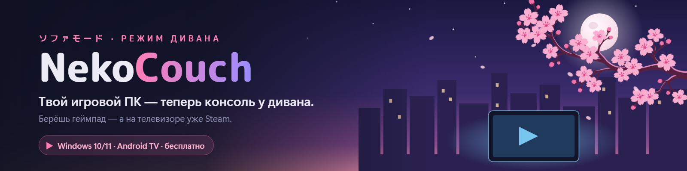
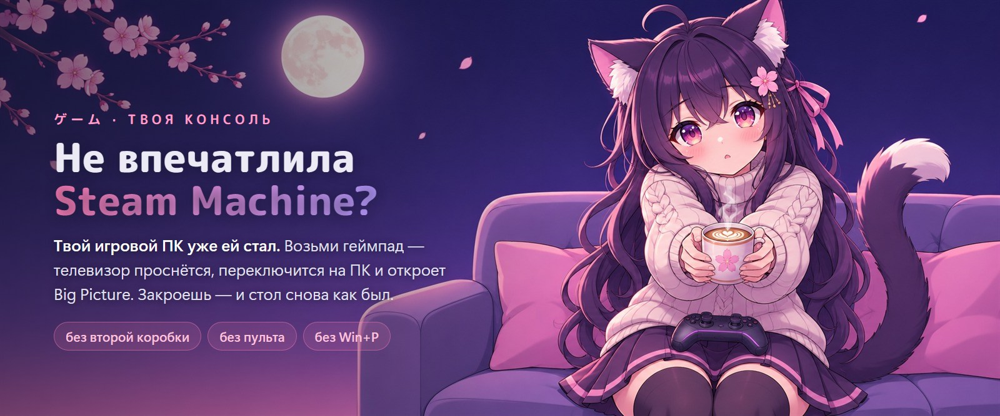
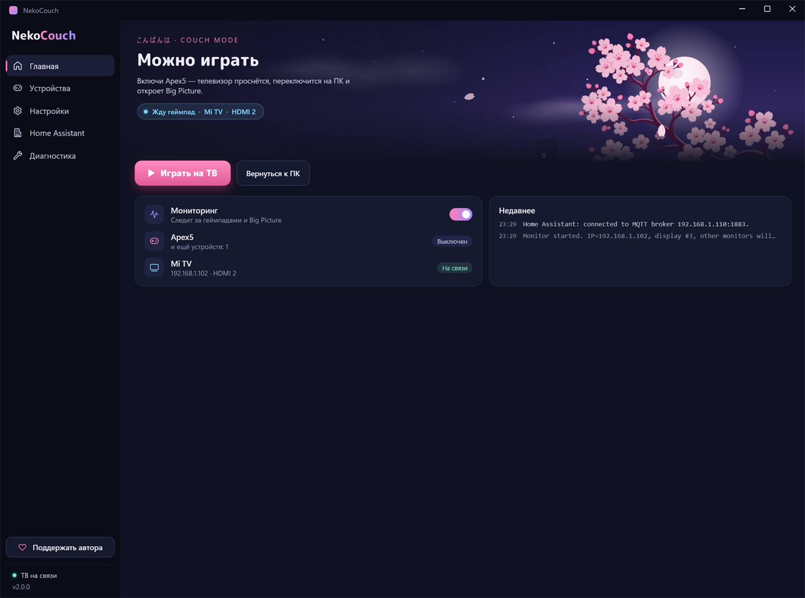
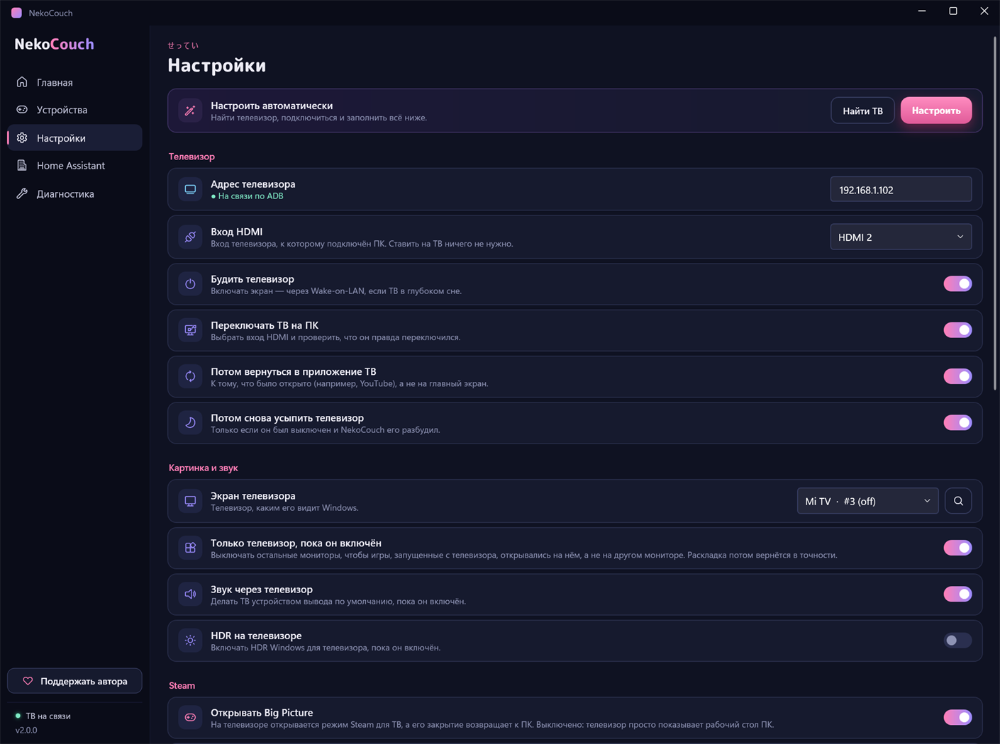
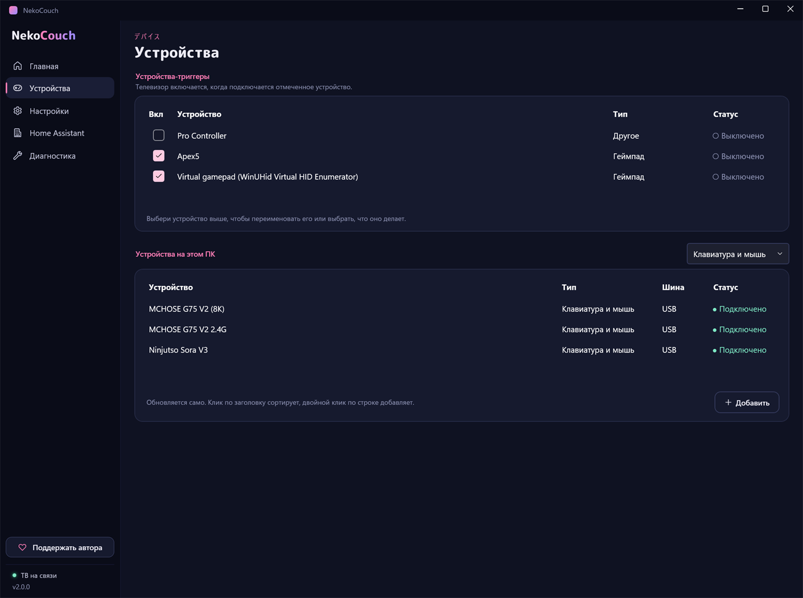
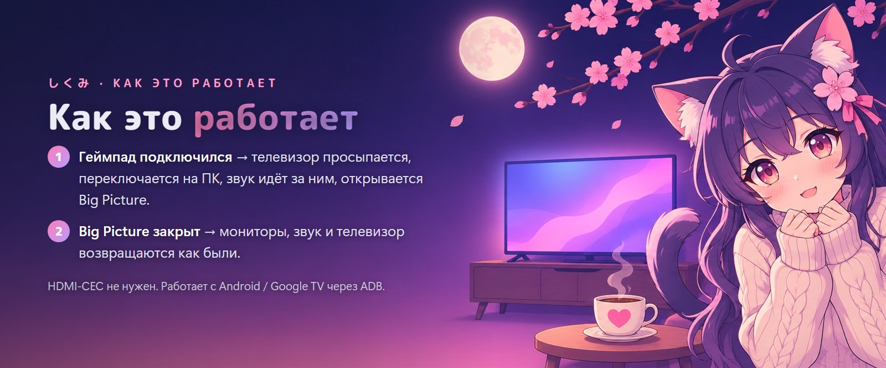
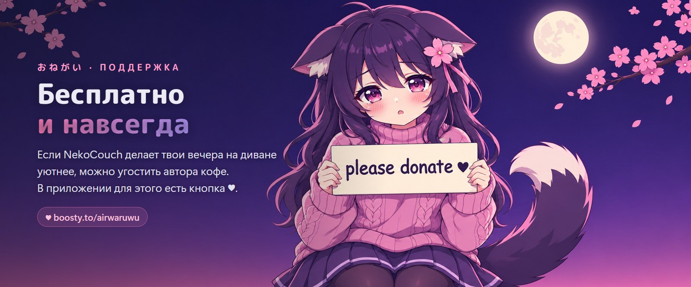

  

<a href="README.md">English</a> · <b>Русский</b>

  
  
  
  
  

Раньше назывался <b>SteamTV</b>. При обновлении настройки, автозапуск и ярлыки переносятся сами.

  

  

## Что умеет

- 🎮 **Любой геймпад — кнопка «вкл»** — Xbox, DualSense, Switch Pro, 8BitDo, Flydigi…, по USB или Bluetooth, в том числе через DS4Windows или Switch2Connect.
- 🪄 **Настраивается сам** — находит телевизор в сети и заполняет вход HDMI, экран телевизора и Steam. Не нужно искать IP-адреса и вводить команды ADB, на телевизор ничего ставить не надо.
- 📺 **Берёт телевизор на себя** — будит его (в том числе через Wake-on-LAN), переключает вход и проверяет, что он правда переключился; потом возвращает то, что было на экране, и снова усыпляет, если телевизор был выключен.
- 🖥️ **Рабочее место не страдает** — по желанию на время игры остаётся включённым только телевизор; расположение мониторов, частота и звуковое устройство потом возвращаются как были.
- ⌨️ **Горячие клавиши и трей** — Ctrl+Alt+9 / Ctrl+Alt+0 (или одна клавиша на оба действия), «Играть на ТВ» / «Вернуться к ПК» из трея.
- 🏠 **Home Assistant** (по желанию) — переключатели для дашбордов и голосовых ассистентов, плюс сон, выключение и перезагрузка ПК.
- 🌙 **Уютно и тихо** — спокойная ночная тема с анимированной сакурой (анимация выключается одним переключателем), русский и английский, раз в день проверяет обновления и ставит их в один клик, живёт в трее.

## Быстрый старт

1. **Скачай** `NekoCouch-vX.Y.Z-win.zip` из [последнего релиза](https://github.com/AirwarQQ/NekoCouch/releases/latest), распакуй куда угодно и запусти `NekoCouch.exe`.
2. **На телевизоре** включи *Для разработчиков* (Настройки → Настройки устройства → Об устройстве → 7 раз нажми на *Сборку*) и включи **отладку по USB / по сети**.
3. При первом запуске NekoCouch **настроится сам**. Когда телевизор спросит *«Разрешить отладку по USB?»*, согласись и отметь *Всегда разрешать*.
4. На странице **Устройства** отметь свой геймпад. Включи его — телевизор включится следом.

Включи в настройках **Запускать вместе с Windows** — и открывать NekoCouch больше не придётся.

  
  &nbsp;
  

## Советы

- **Держи экран телевизора отключённым в Windows** (Параметры → Система → Дисплей → *Отключить этот дисплей*). NekoCouch включает его на время игры и потом снова отключает, так что за столом он не мешает.
- **«Только телевизор, пока он включён»** стоит включить: когда остальные мониторы выключены, игры из Big Picture открываются на телевизоре, а не на мониторе.
- **Телевизор далеко от ПК?** Оптический HDMI-кабель спокойно работает на 15–20 м — у автора всё на нём.
- **Отладка по сети выключается сама** на многих телевизорах после перезагрузки. У автора её держит включённой **tvQuickActions**; то же делают [adb-auto-enable](https://github.com/mouldybread/adb-auto-enable) и [KeepADB](https://f-droid.org/packages/de.hohnepeople.keepadb/).
- **Когда геймпад отключился,** NekoCouch может сам вернуться к ПК — это включается для каждого устройства на странице «Устройства», а сколько ждать, задаётся в настройках.

  

## Home Assistant

По желанию. На странице **Home Assistant** укажи MQTT-брокер (например, дополнение Mosquitto) и включи. Устройство **NekoCouch** появится само, с двумя переключателями — **Gamepad monitoring** (мониторинг геймпадов) и **Steam on TV** (Steam на ТВ), — а если разрешишь, ещё и с кнопками **Sleep**, **Shut down** и **Restart** для ПК. Включать ПК умеет интеграция Wake on LAN в самом Home Assistant; нужный MAC-адрес показан на странице.

Топики MQTT

`<id>` — имя ПК строчными буквами. Топики по-прежнему начинаются со `steamtv/`, старого имени программы, чтобы уже настроенные сущности и автоматизации в Home Assistant продолжали работать.

| Топик | |
|---|---|
| `steamtv/<id>/availability` | `online` / `offline` (retained, last will) |
| `steamtv/<id>/monitoring/state`, `…/steam_on_tv/state` | `ON` / `OFF` (retained) |
| `steamtv/<id>/monitoring/set`, `…/steam_on_tv/set` | отправь `ON` / `OFF` |
| `steamtv/<id>/sleep/set`, `…/shutdown/set`, `…/restart/set` | отправь `PRESS` (если управление питанием разрешено) |

Discovery публикуется заново при каждом перезапуске Home Assistant.

## Если что-то не так

- **«Телевизор недоступен»** — проверь, что телевизор в той же сети и отладка по сети ещё включена (см. «Советы»). Отклонил запрос? На телевизоре *отзови авторизацию отладки по USB* и снова нажми **Настроить**.
- **Телевизор не переключился** — Диагностика → **Switch HDMI Source**: в логе видно, какой способ пробовался и почему не сработал.
- **Включился не тот экран** — выбери телевизор в Настройки → **Экран телевизора**.
- **Звук остался на ПК** — Диагностика → **List Sound Devices**, пока телевизор включён; если его название необычное, впиши часть названия в Настройки → Дополнительно.
- **Геймпада нет в списке** — Bluetooth-устройства сначала подключи в Windows; при работе через программы-мосты добавляй **Virtual gamepad (…)**, а не USB-адаптер.
- **Что-то ещё** — меню в трее → **Открыть файл лога**.

## Поддержать

<b><a href="https://boosty.to/airwaruwu/donate">♥ Поддержать NekoCouch на Boosty</a></b>

---

Сделано на [WPF-UI](https://github.com/lepoco/wpfui); заголовки — шрифтом [M PLUS Rounded 1c](https://github.com/coz-m/MPLUS_FONTS) (SIL OFL); `adb.exe` из Android Platform Tools (Apache 2.0). Ветки сакуры и кошкодевочки нарисованы с помощью ИИ, остальная графика своя. Собрать самому: `dotnet build -c Release`. Лицензия [MIT](LICENSE).
